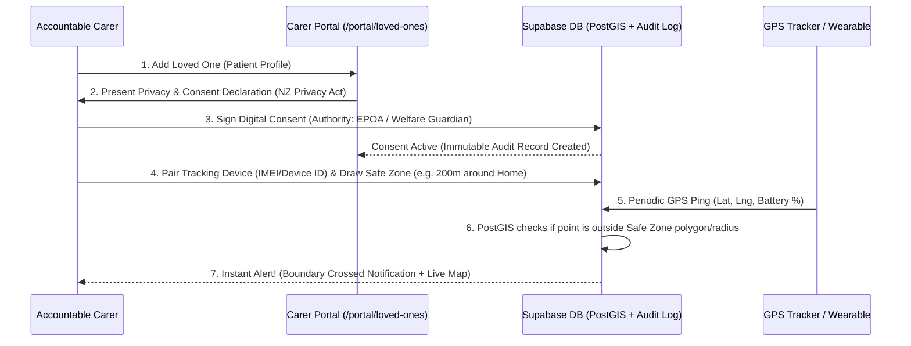

# Le Malaga: Carer, Moderator & Admin Portal Specification

> [!TIP]
> **🚀 Interactive Clickable Prototype Preview (External HTML Viewer):**
> Click here to open the standalone interactive prototype (hosted via `htmlpreview.github.io`, completely separate from the live `lemalaga.org` website):
> 👉 **[Launch Interactive Prototype Preview](https://htmlpreview.github.io/?https://github.com/Le-Malaga/le-malaga.github.io/blob/main/prototype/index.html)**

## 1. Hosting & Real-Time Architecture

| Layer | Technology | Why It Fits These Requirements |
| :--- | :--- | :--- |
| **Frontend** | **React + Vite + Tailwind** (Hosted on GitHub Pages / Cloudflare Pages) | Zero hosting cost, preserves all existing Le Malaga layouts. |
| **WYSIWYG Editor** | **BlockNote (`@blocknote/react`) + `react-markdown`** | Notion-style drag-and-drop block editor (`⋮⋮` handles) supporting visual image/video resizing, alignment, direct Supabase Storage uploads, and dual `content_markdown` + `content_blocks` (`jsonb`) storage. |
| **Database & Auth** | **Supabase PostgreSQL + Auth + RLS** | Enforces strict Row-Level Security (RLS) so **Rest Home Reviews** and **Patient Data** are locked down at the database level. |
| **Geofence & Alerts** | **Supabase Edge Functions + PostGIS + Supabase Realtime** | PostgreSQL includes **PostGIS** (built-in geospatial math to detect when a device's GPS coordinates cross a virtual border) and **Realtime WebSockets** to push instant wandering alerts to the carer's portal/phone. |
| **Email Notifications** | **Resend (`notifications@lemalaga.org`) + Supabase Edge Functions + `pg_cron`** | Sends calendar invites (`.ics`), automated meeting reminders, moderation approvals, and urgent geofence alerts using your custom `lemalaga.org` domain (3,000 free emails/mo). |
| **File Storage** | **Supabase Storage** | Public bucket for approved story Polaroids/PDF guides; **Private encrypted bucket** for patient photos & consent documents. |

---

## 2. Two-Portal Architecture & 5-Tier Role Matrix

Instead of forcing your team to juggle three separate portals, the platform is split into **two clean portals** after Google Sign-In:
1. **Carer Portal (`/portal`)** — The community & care hub for Carers and Volunteers.
2. **Admin & CMS Portal (`/admin`)** — A unified back-office dashboard where sidebar tabs automatically appear based on the staff member's role (**Moderator**, **Content Editor / CMS**, or **Super Admin**).

| Capability / Module | Public Visitor | Carer / Member (`carer`) | Moderator (`moderator`) | Content Editor (`content_editor`) | Super Admin (`super_admin`) |
| :--- | :---: | :---: | :---: | :---: | :---: |
| Read Public Website & Selected Approved Stories (`/stories`) | ✅ | ✅ | ✅ | ✅ | ✅ |
| Read Public **Guides / Permalinks (`/resources/:slug`)** & **FAQ** | ✅ | ✅ | ✅ | ✅ | ✅ |
| View & Edit **LinkedIn-Style Carer Profiles** *(Members Only)* | ❌ | ✅ | ✅ | ✅ | ✅ |
| Submit **My Story** (For selected public sharing after approval) | ❌ | ✅ (Own) | ✅ | ✅ | ✅ |
| Read & Submit **Rest Home Reviews** *(Members Only)* | ❌ | ✅ | ✅ | ✅ | ✅ |
| Post, Comment & React in **The Village Feed (`/portal/feed`)** | ❌ | ✅ | ✅ | ✅ | ✅ |
| Propose **New Guides / Version Edits** & Leave **Guide Feedback** | ❌ | ✅ | ✅ | ✅ | ✅ |
| Register **Patients, Consents & Tracking Devices** | ❌ | ✅ (Own Patients) | ❌ *(No access)* | ❌ *(No access)* | 🔍 *(Audit/Compliance only)* |
| **Approve / Moderate Internal Carer Portal Content** (Approve Stories for *Carer Portal Only*, Rest Home Reviews, Village Feed) | ❌ | ❌ | ✅ | ❌ | ✅ |
| **Publish Anything to Public Website** (Select/Publish Stories to Public `/stories`, Public Guides, Public Events, *About Us*, *Home*, *Policies*) | ❌ | ❌ | ❌ *(Cannot publish to public)* | ✅ | ✅ |
| **Manage Calendar Events & Send Resend Email Broadcasts** | ❌ | ❌ | ✅ (Internal) | ✅ (Public & Internal) | ✅ |
| **Manage User Roles** (Assign Moderators, Content Editors & Super Admins) | ❌ | ❌ | ❌ | ❌ | ✅ |

> [!IMPORTANT]
> **Strict Separation Between Internal Moderation & Public Publishing:**
> - **Moderators (`moderator`)** only govern content *inside* the logged-in Carer Portal (approving stories for `portal_only`, moderating the Village Feed, and approving members-only Rest Home Reviews).
> - **Content Editors (`content_editor`)** (and `super_admin`) have exclusive control over **everything that appears on the Public Website**—including deciding which Carer Stories (`public_portal`), Guides, Events, and Pages are published publicly, regardless of whether a story was already approved for the internal Carer Portal.

> [!IMPORTANT]
> **Strict Patient Privacy Separation:**
> Even `moderator` users **cannot** view registered patients or GPS locations. A patient's profile and tracking device location are strictly visible only to the accountable `carer` who registered them (and any secondary family carers they explicitly authorize).

---

## 3. Core Portal Modules

### Module A: Members-Only LinkedIn-Style Carer Profile (`/portal/profile` & `/portal/carers/:username`)
- **Strictly Private to Logged-In Members:** Carer profiles are **never** public on the open internet. Only registered, authenticated Le Malaga members inside the portal can view carer profiles. (On the public site, only selected, moderator-approved stories appear on `/stories`).
- **Google Sign-In Only (Supabase OAuth):** Carers and admins sign up and log in with a single click using **"Continue with Google"** (`supabase.auth.signInWithOAuth({ provider: 'google' })`).
- **Visual Header & Bio:** Custom Cover Banner image, Profile Photo, Display Name, Headline/Mantra (e.g., *"Full-time Carer for Mum & Dementia Advocate"*), and "About My Malaga" bio.
- **"Caring Experience & Who I've Cared For" (LinkedIn-Style Experience Section):**
  - Carers can list structured entries honoring who they have cared for and what they learned:
    - **Who I Cared For:** e.g., *My Mother (84)*, *My Father (91)*, *Nana*
    - **Role & Timeframe:** e.g., *Primary Full-Time Carer (2019 – Present)* or *Family Co-Carer (2018 – 2023)*
    - **Condition / Care Type:** e.g., *Alzheimer's & Vascular Dementia*, *Palliative Care*, *Stroke Recovery*
    - **Lived Experience & Skills Gained:** e.g., *Managing Sundowning*, *Navigating NASC & Carer Support*, *EPOA Setup*, *Hoist & Mobility Care*, *Samoan Cultural Care*.
- **Opt-In Location & Contact Info (Among Members Only):**
  - **Profile Visibility (Within Portal):** `Members Only` (visible to other logged-in carers in `/portal`) or `Private` (hidden even from other members).
  - **Location Toggle:** Choose whether to reveal Suburb/City (e.g., *Mangere, Auckland*) to other members so nearby carers can connect.
  - **Contact Info Toggle:** Choose whether to display Email, Phone/WhatsApp, or social links (TikTok, Facebook, Instagram, LinkedIn) to other members and a badge for *"Open to Mentoring / Coffee Catch-ups"*.
- **Wall Activity & Selected Story Link:** Shows their recent Village Feed posts to fellow members, and links to their 5-step story if it has been selected for `/stories`.

### Module B: "Share Your Malaga" — Story Builder & Dual Publish Modes (`/portal/my-story`)
- Guided 5-step timeline editor (`BEFORE CARING`, `WHEN THINGS CHANGED`, `THE UNSEEN DAYS`, `THE TURNING POINT`, `TODAY`) with slanted Polaroid photo uploads.
- **Two Publish Visibility Modes (`visibility_scope`):**
  1. **`portal_only` (Carer Portal Only):** Displayed strictly inside the logged-in Carer Portal (`/portal/stories` and on the carer's member profile `/portal/carers/:username`) for fellow carers to read—never visible on the public website. Can be approved by a **Moderator** or **Content Editor**.
  2. **`public_portal` (Public Website + Carer Portal):** Displayed on the public website (`/stories` carousel & `/stories/:id`) as well as inside the Carer Portal.
- **Exclusive Content Editor Control Over Public Stories:**
  - Even if a story is approved by a Moderator for the internal Carer Portal (`portal_only`), **only a `content_editor` (or `super_admin`)** can promote/publish a story to the Public Website (`public_portal`), or create/publish public stories directly regardless of prior moderator review.

### Module C: Members-Only Rest Home Reviews (`/portal/rest-homes`)
- **Strictly Private to Logged-In Members:** Locked behind authentication and database RLS so carers can share honest experiences safely.
- **Ratings:** Overall (1–5), Dementia Care & Safety (1–5), Cultural Responsiveness / Pasifika Care (1–5), Staff Empathy (1–5).
- **Moderation:** All submitted reviews enter the **Moderator Queue** (`pending_review`) before becoming visible to other carers.
- **Anonymous Option:** Carers can toggle *"Hide my name from other members (Show as Verified Carer)"* while moderators can still verify authenticity.

### Module D: Facebook-Style Social Feed, Reactions & FAQ (`/portal/feed`)
- **The Village Feed (Social Timeline):**
  - **Create Posts:** Carers can share daily check-ins, victories, hard days, photos, or ask questions, tagged by topic (*Daily Care*, *System & Subsidies*, *Wellbeing*, *Sunday Sessions*).
  - **Custom Community Reactions:** One-click reactions on posts and comments:
    - ❤️ **Alofa** (Love)
    - 🙏 **Strength & Prayers**
    - 🤗 **With You** (Support/Hug)
    - 💡 **Helpful**
  - **Nested Comments & Replies:** Full Facebook-style comment threads with nested replies and author profile hover/links so carers can build genuine friendships.
- **Curated FAQ Knowledge Base:**
  - Moderators can pin important posts to the top of the feed or click **"Save to Official FAQ"** on helpful Q&A threads so great advice is never lost in the scroll.

### Module E: Collaborative Guides, Documents, Versioning & Feedback (`/resources` & `/resources/:slug`)
- **Unbreakable Permalinks (`/resources/:slug`):**
  - Every guide, downloadable PDF, checklist, video, and official directory link gets a permanent, human-readable URL (e.g., `lemalaga.org/resources/carer-support-subsidy-guide` or `lemalaga.org/resources/enduring-power-of-attorney`).
- **Full Version History & Changelog (`resource_versions`):**
  - Every guide maintains a complete version log (`v1.0`, `v1.1`, `v2.0`, etc.) storing the snapshot of text/PDFs, who contributed the update, a **Change Summary** (e.g., *"Updated 2026 Carer Support subsidy claim steps"*), and the timestamp.
  - The permalink (`/resources/:slug`) always serves the latest approved version while allowing users to view the **"Last Updated / Version History"** badge—and allowing Admins to roll back to any previous version in one click.
- **Carer Contributions & Proposed Edits:**
  - Carers can click **"Contribute a Resource"** or **"Suggest an Edit / Upload New Version"** on any existing guide (Admins can also grant specific carers a *Trusted Contributor* flag or allow any member to submit proposals).
  - Proposed new guides or version updates enter the **Moderator / Admin Review Queue** (`pending_review`). Once approved, the guide publishes as a new version and automatically displays a **"Contributed by [Carer Profile Link]"** credit badge.
- **Guide Feedback, Ratings & Tip Comments (`resource_comments`):**
  - Each guide page (`/resources/:slug`) includes a dedicated **Community Feedback & Practical Tips** comment section at the bottom where carers can:
    - React / vote *"Was this guide helpful?"*
    - Leave practical tips or lived-experience notes (e.g., *"When filling out page 2 in Counties Manukau, make sure your GP signs section B!"*)
    - Flag if a government phone number or form link has changed so a contributor can publish a new version.
- **Pinned "Essential Links" Sidebar & Personal Bookmarks:**
  - Always-visible quick-access rail alongside the social feed for core guides (Carer Support Subsidy, EPOA, NASC Directory, Pasifika Dementia Framework, 24/7 Helplines), plus 1-click **"Save to My Toolkit"** bookmarking.

### Module F: Calendar Schedules, Events, Meetings & Resend Email Notifications (`/portal/calendar` & Public `/events`)
- **Interactive Community Calendar & Schedule View:**
  - Monthly, Weekly, and Upcoming Agenda views showing:
    - **Sunday Sessions:** Recurring online support group sessions with countdown timer and 1-click Zoom launch for logged-in carers.
    - **Community Workshops & Fono:** In-person gatherings, clinical psychologist webinars, and respite info days.
    - **Peer & Volunteer Meetings:** Small-group check-ins or scheduled volunteer support sessions.
- **1-Click RSVP & External Calendar Sync (`event_rsvps`):**
  - Carers can RSVP (*Going*, *Maybe*, *Can't Make It*) and click **"Add to Google Calendar / Download `.ics`"** so meetings appear right on their phone calendar.
  - Public visitors see public event summaries on `/events`, while private Zoom links and meeting notes are visible only to registered members inside `/portal/calendar`.
- **Automated Email Notifications via Resend (`Supabase Edge Functions`):**
  - Powered by **Resend** (`alofa@lemalaga.org` / `notifications@lemalaga.org`) triggered via Supabase Database Webhooks and scheduled `pg_cron` jobs:
    1. **Calendar & Meeting Emails:** Instant RSVP confirmation (with `.ics` calendar attachment) + automated **24-hour** and **1-hour reminder emails** with the Zoom/location link before an event starts.
    2. **Urgent Geofence Boundary Alerts:** Immediate high-priority email alert to the accountable carer (and designated backup contacts) if a patient's tracking device crosses a safe zone boundary.
    3. **Moderation & Contribution Updates:** Email notification when a carer's submitted Story, Rest Home Review, or Guide Version is approved.
    4. **Village Feed Replies:** Optional email notification when another carer replies to their post or comment.
  - **Carer Notification Settings:** Granular toggles in `/portal/profile` so carers can choose which email notifications they want to receive.

### Module G: Patient Registration, Consent Accountability & Virtual Border Alerts (`/portal/loved-ones`)

1. **Privacy & Consent Accountability Gate (`patient_consents`):**
   - Carers are legally and ethically accountable for the privacy of the person with dementia.
   - Adding a patient requires completing a structured **Consent & Authority Declaration**:
     - **Basis of Authority:** *Person with dementia consented directly (early stage)*, *Enduring Power of Attorney (EPOA) for Personal Care & Welfare*, or *Authorised Family/Whānau Representative*.
     - **Accountability Acknowledgement:** Explicit checkboxes confirming the carer understands data is collected solely for safety/wandering prevention, will not be misused, and can be revoked/deleted at any time.
     - **Audit Log:** Every consent signature, modification, or revocation is timestamped and logged immutably.
2. **Patient Profile (`patients`):**
   - Preferred Name, Age, Photo (stored in a private bucket—only used if the carer triggers a "Missing Person / Community Alert" sheet), Wandering Risk Level, Calming Tips / Languages Spoken (e.g., *Speaks Samoan, responds well to hymns*).
3. **Device Registration & Virtual Borders (`tracking_devices` & `geofence_zones`):**
   - **Device Pairing:** Link a GPS tracker / wearable ID to the patient profile.
   - **Virtual Borders (Safe Zones):** Carer sets a center point (e.g., Home address) and a safe radius (e.g., `150m` or `500m`) and active schedule (e.g., *24/7* or *Nighttime only 8pm–7am*).
   - **Alert History & Live Status:** Shows device battery, last ping time, and triggers an immediate alert banner/notification when a `boundary_exit` event occurs.

### Module H: Unified Admin, Moderation & Website CMS Portal (`/admin`)

#### 1. Public Website CMS & Public Publishing (`/admin/cms`) — *Accessible ONLY to `content_editor` & `super_admin`*
**Rule:** Anything that goes out to the Public Website is strictly controlled by the **Content Editor** (and Super Admin).
- **Public Stories Selection & Publishing:** Content Editors control which stories appear on the public `/stories` carousel (`public_portal`), and can publish, edit, or unpublish any story on the public site regardless of internal moderator approval status.
- **Public Guides & Public Events:** Content Editors decide which Guides (`/resources/:slug`), FAQ items, and Events are visible on the public website vs. kept `members_only`.
- **Public Pages Inventory:** Every existing public page in the repository has been audited so its content can be edited dynamically while strictly preserving the Tailwind layouts:

| Public Route | Current File | What Can Be Managed in `/admin/cms` |
| :--- | :--- | :--- |
| **Global Header & Footer** | `src/components/Layout.tsx` | Contact email (`lemalagajourney@gmail.com`), phone number, location, Givealittle Donate button URL, cultural acknowledgement text, and sponsor/funder logos (`site_settings`). |
| **Home Page (`/`)** | `src/pages/Home.tsx` | Hero title, subtitle, hero image, the 4 Value Pillars, and the 4 Action Cards. *(Next Sunday Session, Upcoming Events, and Featured Stories auto-populate from the database!)* |
| **About Us (`/about`)** | `src/pages/About.tsx` | Hero banner, **Mission Statement** paragraphs, and the **"Meet the Aiga" Team Section** (`team_members` table: add/edit/reorder profiles like Flory, Tasi, and Juita, their multiple photos, bios, and callout boxes like *"The Quiet Solitude of Caregiving"*). |
| **Carer Support (`/carer-support`)** | `src/pages/Support.tsx` | Hero banner, *"How We Can Help"* intro text, and the 3 service cards (*1-on-1 Talanoa*, *Support Groups*, *Sunday Sessions*) + call-request button links. |
| **Sunday Sessions (`/sunday-sessions`)** | `src/pages/SundaySessions.tsx` | Hero banner, session description, photo (`zoom_meeting.jpg`), highlight cards (*Open Talanoa*, *Cameras Optional*), and recurring session details. |
| **Events & Meetups (`/events`)** | `src/pages/Events.tsx` | **Fundraiser Highlight Banner** (e.g., *Moving For Le Malaga - Walk Fundraiser* + Givealittle URL), Upcoming Events (`events` table), and **Recent Gatherings / Community Highlights** (`community_highlights` table: e.g., *West & Central Auckland Catch-Up* photo + story). |
| **Get Involved (`/get-involved`)** | `src/pages/GetInvolved.tsx` | Hero banner, *"Join the Movement"* intro, and the 3 CTA cards (*Become a Member*, *Volunteer*, *Donate or Sponsor*). |
| **Policy & Info Pages (`/privacy`, `/terms`, `/safeguarding`, `/complaints`, `/start`)** | `src/pages/GenericPage.tsx` | Rich-text / Markdown page editor in `site_pages` so legal policies and the *"I'm New to Caring (`/start`)"* guide can be written and updated anytime. |

- **WYSIWYG Drag-and-Drop Editor (`@blocknote/react`):**
  - Used across `/admin/cms` page editors, Collaborative Guides (`/resources/:slug`), and rich stories.
  - **Visual Media Manipulation:** Editors and carers can drag-and-drop images and videos into the editor, grab the **`⋮⋮` drag handle** to move images/videos anywhere on the page, drag corner handles to resize media, and set left/center/right alignment.
  - **Dual Storage Format (`content_markdown` + `content_blocks`):** Every save stores clean, portable **Markdown** (`content_markdown` for version diffs, full-text search, and lightweight rendering) alongside the lossless **BlockNote JSON** (`content_blocks` to preserve exact image widths, alignments, and video embeds).

#### 2. Internal Community Moderation Queue (`/admin/moderation`) — *Accessible to `moderator` & `super_admin`*
- Pending **Carer Stories (Internal Portal Only):** Moderators can preview the 5-step Polaroid layout, Request Edits, or Approve a story **only for the internal Carer Portal (`portal_only`)**. *(Publishing to the Public Website is reserved for Content Editors).*
- Pending **Rest Home Reviews:** Verify and Approve/Reject for the members-only directory.
- Pending **Internal Resource Contributions:** Review member-submitted guides for the internal portal.
- **Village Feed Moderation:** Pin posts, remove inappropriate posts, or flag helpful threads for Content Editors to publish to the public FAQ.

#### 3. Calendar, Events & Email Broadcast Manager (`/admin/events`) — *Accessible to `moderator`, `content_editor` & `super_admin`*
- Create single or recurring events (e.g., weekly Sunday Sessions), view the attendee RSVP list, and trigger a **Resend Email Announcement** to registered carers.

#### 4. User Role & Compliance Manager (`/admin/users`) — *Accessible to `super_admin` only*
- Searchable directory of all registered users (Name, Google Email, Avatar, Region, Joined Date, Current Role).
- **One-Click Role Selector:** Super Admins can change any user's role between `carer`, `moderator`, `content_editor`, and `super_admin` (or toggle *Trusted Resource Contributor* status).
- **Database-Level Security:** A PostgreSQL security trigger (`set_user_role` RPC / RLS check) ensures that **only** a `super_admin` can modify the `role` column—users, editors, and moderators cannot escalate their own role.
- **Initial Super Admin Bootstrap:** Automatically grants `super_admin` to your designated Google email address upon first sign-in.

---

## 4. Database Schema (Supabase PostgreSQL + PostGIS)

```mermaid
erDiagram
    PROFILES ||--o{ CARING_EXPERIENCES : lists
    PROFILES ||--o{ STORIES : writes
    PROFILES ||--o{ REST_HOME_REVIEWS : submits
    PROFILES ||--o{ FEED_POSTS : creates
    PROFILES ||--o{ POST_COMMENTS : replies
    PROFILES ||--o{ POST_REACTIONS : reacts
    PROFILES ||--o{ RESOURCE_VERSIONS : contributes
    PROFILES ||--o{ RESOURCE_COMMENTS : reviews
    PROFILES ||--o{ EVENT_RSVPS : attends
    PROFILES ||--o{ PATIENTS : manages
    EVENTS ||--o{ EVENT_RSVPS : tracks
    FEED_POSTS ||--o{ POST_COMMENTS : has
    FEED_POSTS ||--o{ POST_REACTIONS : receives
    RESOURCES ||--|{ RESOURCE_VERSIONS : tracks
    RESOURCES ||--o{ RESOURCE_COMMENTS : discusses
    PATIENTS ||--|{ PATIENT_CONSENTS : requires
    PATIENTS ||--o{ TRACKING_DEVICES : wears
    PATIENTS ||--o{ GEOFENCE_ZONES : protected_by
    TRACKING_DEVICES ||--o{ GEOFENCE_ALERTS : triggers
    PROFILES ||--o{ SITE_PAGES : edits
    PROFILES ||--o{ TEAM_MEMBERS : manages

    SITE_SETTINGS {
        text key PK "contact_info | donate_urls | footer_text | fundraiser_banner"
        jsonb value
        uuid updated_by FK
        timestamptz updated_at
    }

    SITE_PAGES {
        text slug PK "home | about | carer-support | sunday-sessions | events | get-involved | privacy | terms | start"
        text hero_title
        text hero_subtitle
        text hero_image_url
        text content_markdown "Portable Markdown output"
        jsonb content_blocks "Lossless BlockNote JSON with image/video sizes & positions"
        jsonb structured_sections "Cards, pillars, mission paragraphs"
        uuid updated_by FK
        timestamptz updated_at
    }

    TEAM_MEMBERS {
        uuid id PK "Meet the Aiga on About Us"
        text name "e.g. Flory, Tasi, Juita"
        text role_title
        int display_order
        text[] bio_paragraphs
        text[] photo_urls
        jsonb callout_box "Optional highlight card e.g. The Quiet Solitude of Caregiving"
        boolean is_active
    }

    COMMUNITY_HIGHLIGHTS {
        uuid id PK "Recent Gatherings on Events page"
        text badge_text "e.g. Community Highlight"
        text title "e.g. West & Central Auckland Catch-Up"
        text[] body_paragraphs
        text quote
        text image_url
        int display_order
    }

    PROFILES {
        uuid id PK "auth.users"
        text username UK "For /portal/carers/:username (Members Only)"
        text full_name
        text headline_mantra
        text bio
        text avatar_url
        text cover_banner_url
        text region
        boolean show_location
        text public_contact_info
        boolean show_contact_info
        boolean open_to_mentoring
        text visibility "members_only | private (Never public)"
        text role "carer | moderator | content_editor | super_admin"
        boolean is_trusted_contributor
        jsonb email_preferences "event_reminders | feed_replies | geofence_alerts"
        timestamptz created_at
    }

    EVENTS {
        uuid id PK
        uuid created_by FK
        text title
        text description
        text event_type "sunday_session | workshop | peer_meetup"
        timestamptz start_time
        timestamptz end_time
        text recurrence_rule "Optional RRULE for weekly sessions"
        text location_or_zoom_url
        boolean is_members_only_link
        boolean reminder_24h_sent
        boolean reminder_1h_sent
        timestamptz created_at
    }

    EVENT_RSVPS {
        uuid id PK
        uuid event_id FK
        uuid user_id FK
        text status "going | maybe | declined"
        boolean calendar_invite_emailed
        timestamptz created_at
    }

    CARING_EXPERIENCES {
        uuid id PK
        uuid carer_id FK
        text cared_for_person "e.g. My Mother"
        text relationship "Mother | Father | Nana | Spouse"
        text timeframe "e.g. 2019 - Present"
        text conditions "e.g. Alzheimer's & Vascular Dementia"
        text[] skills_gained
        text reflections
    }

    STORIES {
        uuid id PK
        uuid author_id FK
        text slug UK
        text short_title
        text quote
        text subquote
        text hero_image_url
        boolean allow_public_sharing "Carer consent toggle"
        text visibility_scope "portal_only | public_portal"
        text status "draft | pending_review | published_portal | published_public | changes_requested"
        uuid approved_by FK
        timestamptz created_at
    }

    FEED_POSTS {
        uuid id PK
        uuid author_id FK
        text topic_tag "daily_care | subsidies | wellbeing | sunday_sessions"
        text body
        text[] media_urls
        boolean is_pinned
        boolean is_faq
        timestamptz created_at
    }

    POST_COMMENTS {
        uuid id PK
        uuid post_id FK
        uuid parent_comment_id FK "Nullable for nested replies"
        uuid author_id FK
        text body
        timestamptz created_at
    }

    POST_REACTIONS {
        uuid id PK
        uuid post_id FK
        uuid comment_id FK
        uuid user_id FK
        text reaction_type "alofa | strength | with_you | helpful"
    }

    RESOURCES {
        uuid id PK
        text slug UK "For /resources/:slug"
        text title
        text category "system | legal | daily_care | wellbeing"
        boolean is_pinned_essential
        boolean members_only
        uuid current_version_id FK
        timestamptz created_at
    }

    RESOURCE_VERSIONS {
        uuid id PK
        uuid resource_id FK
        uuid contributor_id FK
        text version_label "e.g. v1.2"
        text change_summary
        text content_markdown "Rendered Markdown content"
        jsonb content_blocks "BlockNote WYSIWYG layout blocks"
        text file_or_external_url
        text status "pending_review | approved | archived"
        uuid approved_by FK
        timestamptz created_at
    }

    RESOURCE_COMMENTS {
        uuid id PK
        uuid resource_id FK
        uuid author_id FK
        boolean is_helpful_vote
        boolean flags_outdated_info
        text comment_body
        timestamptz created_at
    }

    PATIENTS {
        uuid id PK
        uuid primary_carer_id FK
        text preferred_name
        int birth_year
        text languages_spoken
        text calming_notes
        text private_photo_path
        boolean tracking_enabled
        timestamptz created_at
    }

    PATIENT_CONSENTS {
        uuid id PK
        uuid patient_id FK
        uuid accountable_carer_id FK
        text authority_basis "direct_consent | epoa | whanau_authority"
        text consent_statement_version
        boolean privacy_accountability_accepted
        text supporting_doc_path
        timestamptz consented_at
        timestamptz revoked_at
    }

    TRACKING_DEVICES {
        uuid id PK
        uuid patient_id FK
        text device_serial_or_imei
        text device_label
        int battery_percent
        float last_lat
        float last_lng
        timestamptz last_ping_at
        text status "active | offline | paused"
    }

    GEOFENCE_ZONES {
        uuid id PK
        uuid patient_id FK
        text zone_name
        float center_lat
        float center_lng
        int radius_meters
        boolean is_active
    }

    GEOFENCE_ALERTS {
        uuid id PK
        uuid patient_id FK
        uuid device_id FK
        uuid zone_id FK
        text alert_type "boundary_exit | boundary_enter | low_battery"
        float trigger_lat
        float trigger_lng
        boolean acknowledged
        uuid acknowledged_by FK
        timestamptz created_at
    }
```

---

## 5. Phased Implementation Roadmap

### Phase 1: Google Auth, 5-Tier Roles & Members-Only Carer Profiles
- Set up Supabase client configuration (`src/lib/supabase.ts`) + SQL migration script for all tables, triggers, and RLS policies.
- Build `/portal/login` with **"Continue with Google"** and role-aware navigation (`/portal` for Carers, `/admin` for Moderators, Content Editors & Super Admins).
- Build `/portal/profile` and members-only `/portal/carers/:username` with Caring Experience cards and opt-in Location/Contact toggles.

### Phase 2: Facebook-Style Village Feed + Collaborative, Versioned Guides
- Build `/portal/feed` with posts, nested comments/replies, custom reactions (`Alofa`, `Strength`, `With You`, `Helpful`), and the Pinned Essential Links sidebar.
- Upgrade `/resources` and `/resources/:slug` with unbreakable permalinks, version history (`resource_versions`), Carer Contributions, and Guide Feedback comments.

### Phase 3: Members-Only Rest Home Reviews & Story Builder
- Build `/portal/rest-homes` (members-only directory + review submission form with Cultural Responsiveness ratings and Anonymous toggle).
- Build `/portal/my-story` (5-step Polaroid story submission).

### Phase 4: Patient Registration, Consent Ledger, Geofence Alerts & Admin Portal
- Build `/portal/loved-ones` with the mandatory **Consent & Privacy Accountability Wizard**, Patient Profile card, and **Device & Virtual Border Manager**.
- Build `/admin` with User Role Management (`super_admin`), Content Moderation queues (`moderator` & `super_admin`), and Guide Version approval/rollback.
